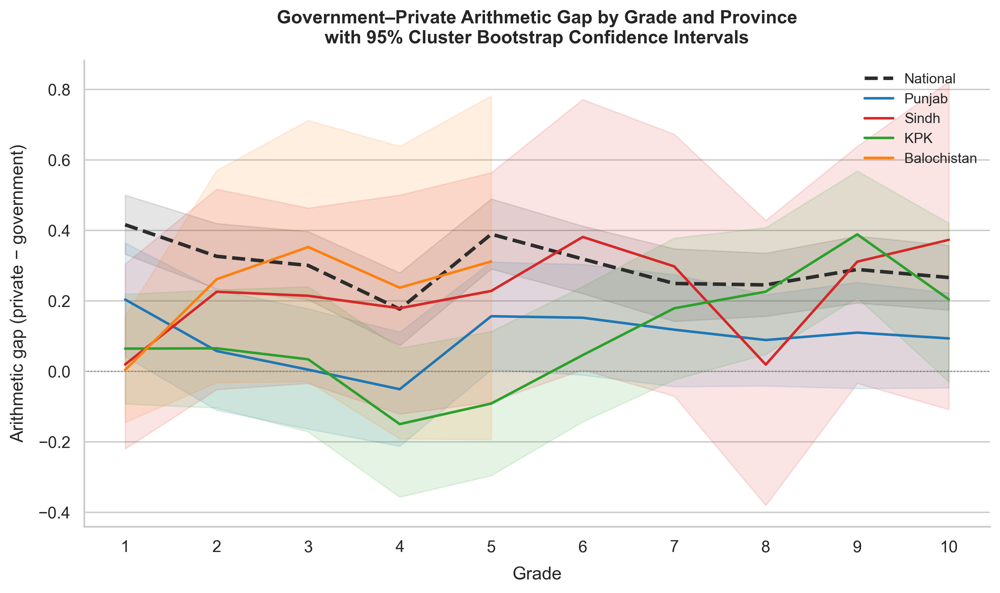

# Mapping and Predicting Educational Inequality in Pakistan

District-level evidence from ASER 2023 on the learning gap between government and private schools.

Children in Pakistan's government and private schools take the same ASER tests, but they don't get the same results. This project measures how large that gap is, where it is widest and narrowest, and which children are most at risk of dropping out before finishing middle school. It uses the Annual Status of Education Report (ASER) 2023 survey: about 214,000 children across 150 districts, tested in arithmetic, Urdu reading and English reading.



*Nationally (dashed line), private-school students lead government-school students in arithmetic at every grade from 1 to 10. Shaded bands are 95% cluster-bootstrap confidence intervals.*

## Research questions

1. How large is the government-private learning gap in arithmetic, Urdu and English, and how does it vary by province, grade and gender?
2. Which household and school characteristics predict a child dropping out before completing middle school?
3. Which districts show the widest and narrowest gaps, and do school operational metrics explain why the gap varies between districts?

## Key findings

- The arithmetic gap between government and private school students appears in grade 1 and holds at every grade nationally; the cluster-robust confidence intervals exclude zero at every grade.
- 78% of observed dropouts happen in middle and secondary school (grades 6 to 10). School stage and education expenditure are the strongest predictors in the dropout model.
- Government schools have a mean pupil-teacher ratio of 28.1, about 60% higher than private schools (17.6), after excluding recorded ratios above 100:1 as data errors. Medians point the same way. Teacher attendance is about 13 percentage points lower in government schools.
- Textbook availability in government Grade 2 classrooms averages 17.9% nationally. In Punjab's government schools it averages 35.7%, more than double.
- Government schools lead in twelve districts (eleven in Punjab, plus Haripur in KPK). All twelve hold up under a village-cluster bootstrap, with 95% confidence intervals entirely below zero, and several also beat national government-school benchmarks on multiple school resource measures.

All inferential estimates use cluster-robust (village-level) bootstrap confidence intervals, to account for ASER's two-stage cluster sampling design.

## Repository layout

```
notebooks/         The 15 analysis notebooks listed below
outputs/figures/   Figures from the notebooks, as PNG and PDF
requirements.txt   Python dependencies
```

## Notebooks

| Notebook | What it covers |
|---|---|
| `01_gap_by_grade.ipynb` | Government-private arithmetic gap by grade and province |
| `02_sample_size_check.ipynb` | Sample size audit and coverage heatmap across provinces and grades |
| `03_district_rankings.ipynb` | District gap rankings: the 30 widest and 15 narrowest gaps |
| `04_socioeconomic_correlations.ipynb` | Socioeconomic correlates of learning: electricity access, asset index, BISP/Ehsaas receipt |
| `05_competency_rates.ipynb` | Proficiency rates by school type: story reading, sentence reading, division, subtraction |
| `06_school_resources.ipynb` | School resources by type and province: pupil-teacher ratios, attendance, classroom resources |
| `07_dropout_model.ipynb` | Logistic regression and gradient boosting dropout risk models, with provincial coefficients |
| `08_district_outlier_check.ipynb` | Data quality audit and district-level outlier flags |
| `09_grade_gap_bootstrap.ipynb` | Grade-by-grade arithmetic gap with cluster-robust bootstrap CIs; gender difference test |
| `10_dropout_robustness.ipynb` | Robustness checks for the dropout model across subsamples and specifications |
| `11_bisp_diagnosis.ipynb` | BISP/Ehsaas transfer coverage and its relationship to district learning outcomes |
| `12_distributional_views.ipynb` | Score distributions and inequality within each school type, by province |
| `13_punjab_verification.ipynb` | Bootstrap verification of the government-school lead in 12 districts, with a resource check |
| `14_punjab_textbook_check.ipynb` | Textbook availability by Punjab district, compared with national government benchmarks |
| `15_cluster_bootstrap.ipynb` | District-level cluster-robust bootstrap CIs; top-10 and bottom-15 gap tables |

## Data

The raw ASER 2023 data isn't included here because of its licence. You can request it from ASER Pakistan at [aserpakistan.org](https://aserpakistan.org).

Once you have it, place the pre-processed CSV files in a folder named `Data:` (the colon is part of the folder name):

```
Data:/child_merged.csv
Data:/district_summary.csv
Data:/grade_level_gaps.csv
Data:/school_resources.csv
```

Notebooks 09 and 15 also load village codes from the raw ASER child-level Excel file. The default path is `../data/raw/ITAASER2023Child.xlsx`; to use a different location, set the `ASER_CHILD_XLSX` environment variable before launching Jupyter:

```bash
export ASER_CHILD_XLSX=/path/to/ITAASER2023Child.xlsx
```

## Setup

Requires Python 3.9 or later.

```bash
git clone https://github.com/sherazhassan7/educational-inequality-pakistan.git
cd educational-inequality-pakistan
python -m venv venv
source venv/bin/activate        # Windows: venv\Scripts\activate
pip install -r requirements.txt
jupyter notebook
```

## Related writing

I wrote about what this data shows in an op-ed for *Pakistan Today*: ["We Never Did the Sums"](https://www.pakistantoday.com.pk/2026/07/28/we-never-did-the-sums-2) (July 2026).

## License

MIT License. See [LICENSE](LICENSE).
